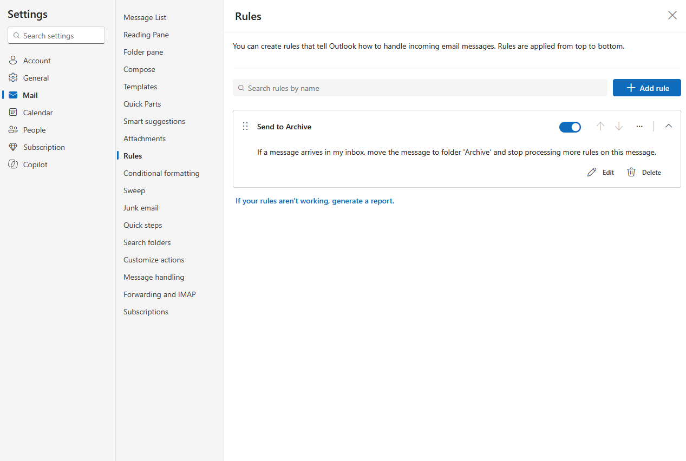
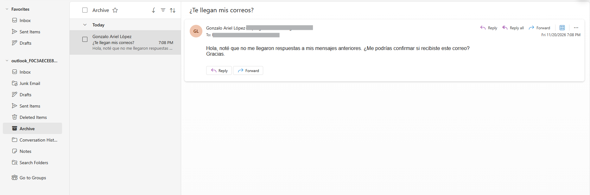
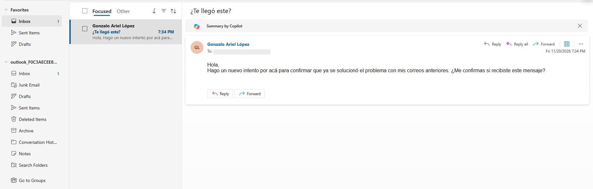
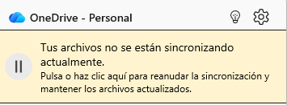
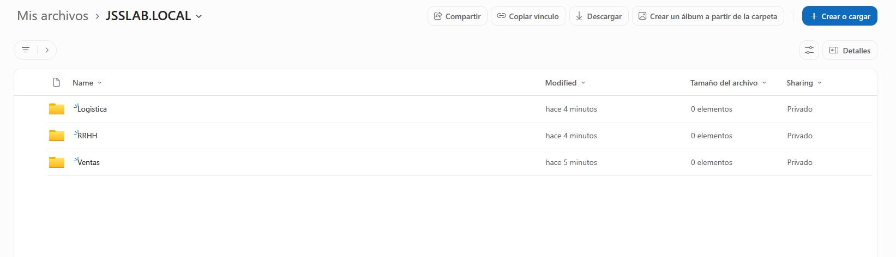
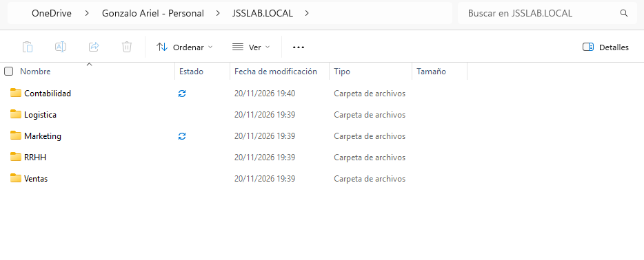
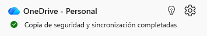
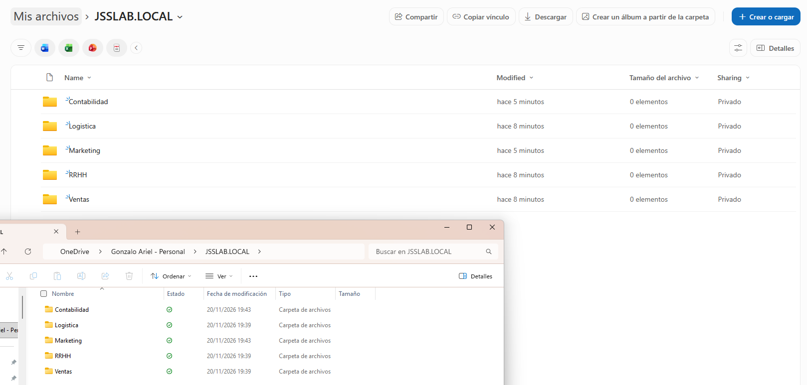

# Microsoft 365 — Tickets de Soporte Técnico N1

Documentación de incidentes simulados utilizando herramientas gratuitas de Microsoft 365, enfocados en diagnóstico, resolución y validación de problemas frecuentes de usuarios.

## M365-001 — Problema de recepción de correos en Outlook

**Servicio:** Outlook Web  
**Estado:** Resuelto

**Problema:** Un usuario no recibe determinados correos en su bandeja de entrada.

**Diagnóstico:** Se identifica una regla de Outlook que mueve automáticamente los mensajes a otra carpeta.

**Solución:** Se desactiva la regla y se realiza una nueva prueba de recepción.

**Resultado:** Los correos llegan correctamente a la bandeja de entrada.

### Evidencias

---

## M365-002 — Problema de sincronización en OneDrive

**Servicio:** OneDrive (Windows 11 / Web)  
**Estado:** Resuelto

**Problema:** Los archivos modificados localmente no se actualizan en OneDrive Web.

**Diagnóstico:** Se detecta que la sincronización del cliente OneDrive está pausada.

**Solución:** Se reanuda la sincronización desde el cliente de Windows.

**Resultado:** Se verifica que los archivos se actualizan correctamente en la nube.

### Evidencias

---

**Entorno:** Windows 11, Outlook Web, OneDrive y cuentas personales de Microsoft.

*Incidentes simulados en un entorno de laboratorio con fines de aprendizaje y documentación técnica.*